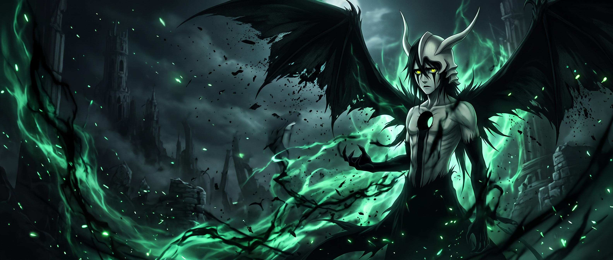

 <div align="center">



# GABRIEL FONSECA
### `THE VOID // SOFTWARE DEVELOPER`

**Estagiário na IBM · Desenvolvedor em evolução · Entusiasta de tecnologia**

[](https://www.ibm.com/)
[](https://github.com/FoonsGabriel)

</div>

---

## 01. SOBRE MIM

```yaml
name: Gabriel de Souza Fonseca
role: IBM Intern
focus: Software Development
mindset: Always Learning
```

Sou estudante e entusiasta de tecnologia, apaixonado por desenvolvimento de software e criação de soluções.

Atualmente, atuo como **estagiário na IBM**, buscando desenvolver minhas habilidades, aprender novas tecnologias e transformar ideias em projetos reais.

Acredito que programação é mais do que escrever código: é resolver problemas, explorar possibilidades e evoluir constantemente.

---

## 02. TECNOLOGIAS

<div align="center">


</div>

---

## 03. PROJETOS

### ⚔️ Shinobi VTT — NarutoTabletop

Projeto de Virtual Tabletop inspirado no universo Naruto, com foco em mapas interativos, tokens e ferramentas para experiências de RPG de mesa.

### 🧪 GastroSynq

Projeto de tecnologia voltado à criação de soluções digitais, explorando desenvolvimento de software e integração de funcionalidades.

---

</div>

---

## 04. CONECTE-SE COMIGO

<div align="center">

[](https://github.com/FoonsGabriel)

</div>

---

<div align="center">

### 「 A ausência de sentido... é o que define o vazio. 」

**ULQUIORRA // THE VOID**

<sub>Building. Learning. Evolving.</sub>


</div>
